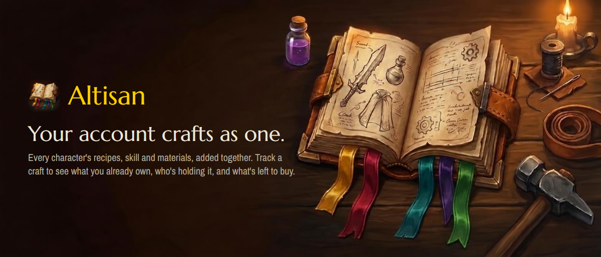

# Altisan

Every character's professions, recipes and materials in one window. For WoW: Forever.

- See every character's professions and skill on one page, with what to do next.
- Hover a material to see which of your characters use it.
- Find where to learn a recipe, with a pin on the map.
- See which recipes your account is missing, and who can learn them.
- Track a craft: what to make, what to mail and what to buy.

## Install

Install it from [CurseForge](https://www.curseforge.com/wow/addons/altisan).

## Use

Click the minimap button or type `/alt`. On each character, open each profession window once so
Altisan can read its recipes.

## Report a bug

[Open a bug report](https://github.com/ImCheesecake/Altisan/issues/new/choose).

## License

GPLv3, see `LICENSE`. The libraries in `Libs/` keep their own licenses, listed in
`Libs/README.md`.
